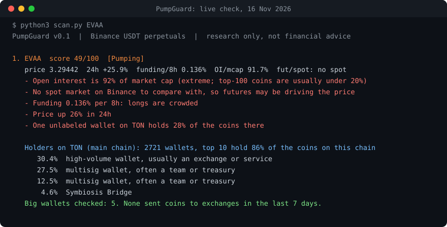

# PumpGuard

**Spot pump-and-dump setups before you become the exit liquidity.**

A free, open-source Claude skill and scanner. Ask Claude "check EVAA" and get a score from 0 to 100, the stage of the pump-and-dump pattern the coin seems to be in, who holds it, and whether big wallets are sending coins to exchanges, all in plain English.



*A real check from 16 Nov 2026. Research only, not financial advice.*

**Quick start** (Python 3.8+, no installs, no API keys):

```
git clone https://github.com/iqbal-ops123/pumpguard.git
python3 pumpguard/skill/pumpguard/scan.py EVAA
```

**What it checks**

- **Borrowed money:** how big the bets on a coin are compared with the coin itself, futures vs. normal trading, and who is crowded (buyers or short-sellers)
- **Who holds it:** the biggest wallets on each blockchain, with exchanges, bridges and pools labeled
- **Big wallets moving to exchanges:** coins sent to exchanges in the last 24 hours and 7 days (TON and Ethereum so far)
- **Contract traps:** honeypots, owners who can change balances, high sell taxes

## Use it as a Claude skill

You need Python 3.8 or newer. Nothing else to install, and no API key.

- **Mac:** Python is usually already installed. Check by typing `python3 --version` in Terminal.
- **Windows:** install Python from [python.org](https://www.python.org/downloads/) and tick "Add python.exe to PATH" during setup. On Windows, type `python` or `py` wherever this page says `python3`.
- **Linux:** Python 3 is usually already installed.

**Claude Code**

```
git clone https://github.com/iqbal-ops123/pumpguard.git
mkdir -p ~/.claude/skills
cp -r pumpguard/skill/pumpguard ~/.claude/skills/
```

Then open Claude Code and type: `check BTC`

**Claude app (claude.ai or desktop)**

1. Download this repo (green "Code" button, then "Download ZIP") and unzip it.
2. Find the folder `skill/pumpguard` and zip that folder on its own.
3. Upload the zip as a new skill in Claude's skills settings.
4. Ask Claude: `check BTC`

Note: Binance blocks some countries and some cloud servers. The skill needs to run somewhere Binance allows. If Claude says Binance refused the request, use Claude Code on your own computer instead.

## Use it without Claude

```
python3 skill/pumpguard/scan.py            # 10 most fragile coins right now
python3 skill/pumpguard/scan.py PEPE RAVE  # check specific coins
python3 skill/pumpguard/scan.py --json BTC # raw numbers
```

On Windows, use `py` instead of `python3`, for example `py skill\pumpguard\scan.py PEPE`.

## What the stages mean

| Stage | Meaning |
|---|---|
| Squeeze setup | Many people are betting on a fall in a fragile market. A squeeze can push the price up first. |
| Squeeze in progress | The price is being pushed up while people bet on a fall. Shorting now is risky. |
| Pumping | Rising fast on borrowed money. Late buyers are at risk. |
| Possible distribution | Borrowed money is leaving after a pump. A drop may be starting. |
| Post-dump | A crash has probably already happened. |
| Fragile / Watch / Quiet | From more to less concern. |

## Why

Many coins on exchanges like Binance and Bitget pump hard for no clear reason, then crash 80 to 99%. Most of these moves follow the same pattern: a small real float held by a few wallets, a perpetual futures market, crowded shorts, a forced short squeeze, and then insiders selling into the squeeze. Retail traders end up as the exit liquidity, whether they bought the top or shorted too early.

PumpGuard does not predict prices. It scores how fragile a market looks and explains every flag so you can check the evidence yourself.

## What it looks at

- **Live Binance futures data:** open interest compared with market cap, futures volume compared with spot volume, funding rates, how fast open interest is changing, the 24-hour price move, and whether big accounts and most accounts are betting opposite ways.
- **Blockchain holders** (CoinGecko, GoPlus, TonAPI, Blockscout): top wallets on each chain, wallet types, and contract risks.
- **Wallet movements:** whether the biggest unknown wallets sent coins to labeled exchange wallets recently.

## Status and limits

Version 0.1. The score thresholds are starting points that have not yet been tested against past crashes. Futures data covers the last 24 hours. Holder shares are of the coins on one blockchain, not the whole supply. Wallet movement tracking covers TON and Ethereum so far, only recognizes labeled exchange wallets, and cannot yet follow coins through middle wallets. Coming next: a library of past cases (OM, MYX, COAI, JELLYJELLY, RAVE and others) to test and tune the scores.

## Disclaimer

This is a research and education tool. It is not financial advice. A high score means a market looks fragile based on public data. It is not a claim that any project or person did anything wrong. Always do your own research.

## License

MIT
